<!--
  Kavin Krish Vijay · github.com/krishkavin7512
  Static SVGs  →  python scripts/build.py
  Telemetry + snake  →  .github/workflows/profile.yml (nightly, output branch)
-->

  

 


  <a href="https://github.com/krishkavin7512/DevTrails"></a>
  <a href="https://github.com/VishaalPillay/WSF"></a>

  <a href="https://github.com/krishkavin7512/Indian-Sign-Language-Detection-System"></a>
  <a href="https://github.com/GoutamAdityan/PRO-TECHT"></a>

 


  

 


  
    
  <picture>
    <source media="(prefers-color-scheme: dark)" srcset="https://raw.githubusercontent.com/krishkavin7512/krishkavin7512/output/snake-dark.svg" />
    <source media="(prefers-color-scheme: light)" srcset="https://raw.githubusercontent.com/krishkavin7512/krishkavin7512/output/snake-light.svg" />
    
  </picture>

 


  
    
  
  <a href="https://www.linkedin.com/in/kavin-krish-vijayakumar-029526277/"></a>
  <a href="https://kavin-dev-portfolio.vercel.app/"></a>

 

plain-text version

 

**Kavin Krish Vijay**: applied ML × full-stack engineer, B.Tech CSE at SRM IST ('28), Chennai. Vibe-coded speed, engineered depth: I ship with AI agents, then I read every line they write.

- **RainCheck** ([repo](https://github.com/krishkavin7512/DevTrails)): parametric income insurance for food-delivery riders, Guidewire DEVTrails 2026. I built the Flutter rider app.
- **WSF** ([repo](https://github.com/VishaalPillay/WSF)): AI women's safety framework with risk zones, safe routing and auto-SOS. I rebuilt location tracking and unified the Supabase schema.
- **ISL Recognition** ([repo](https://github.com/krishkavin7512/Indian-Sign-Language-Detection-System)): real-time Indian Sign Language recognition, 92.2% val accuracy on 296 signs. Solo build.
- **Pro-Techt** ([repo](https://github.com/GoutamAdityan/PRO-TECHT)): service-center portal with warranty tracking, OCR + barcode capture and SLA analytics.

Open to internships · [krishkavin7512@gmail.com](mailto:krishkavin7512@gmail.com) · [LinkedIn](https://www.linkedin.com/in/kavin-krish-vijayakumar-029526277/) · [Portfolio](https://kavin-dev-portfolio.vercel.app/)

